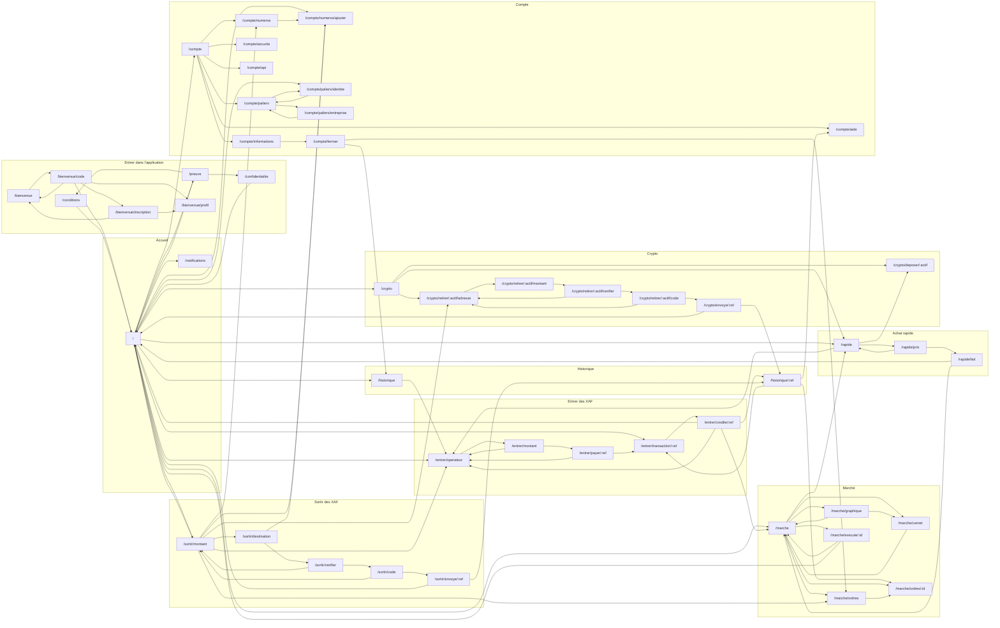

# La carte des écrans

*Tirée du code par `app/scripts/carte.mjs` — ne pas modifier à la main. Relancer `node scripts/carte.mjs` après tout changement de navigation.*

48 écrans · 134 passages (sans compter la barre d'onglets, présente sur les quatre écrans racines).

## Les modules et leurs passages

Les flèches « retour » et les onglets ne sont pas dessinés : chaque écran en a, le tableau ci-dessous le dit.

## Écran par écran

| Écran | Touchers depuis l'Accueil | On en sort par | Mène vers |
|---|---|---|---|
| `/conditions` | 0 | flèche, lien | `/` |
| `/confidentialite` | 0 | flèche, lien | `/` |
| `/preuve` | 0 | lien | `/` `/conditions` `/confidentialite` |
| `/bienvenue` | 0 | lien | `/bienvenue/code` |
| `/bienvenue/code` | 1 | flèche, lien | `/bienvenue` `/bienvenue/inscription` `/bienvenue/profil` `/` |
| `/bienvenue/inscription` | 2 | flèche, lien | `/bienvenue` `/bienvenue/profil` |
| `/bienvenue/profil` | 2 | flèche | — |
| `/` | 0 | onglets, lien | `/compte` `/notifications` `/preuve` `/entrer/transaction/:ref` `/entrer/operateur` `/sortir/montant` `/crypto` `/marche` `/rapide` `/compte/numeros/ajouter` `/compte/paliers/identite` `/historique` |
| `/notifications` | 1 | flèche | — |
| `/entrer/operateur` | 1 | flèche, lien | `/entrer/montant` |
| `/entrer/montant` | 2 | flèche, lien | `/entrer/operateur` `/entrer/payer/:ref` |
| `/entrer/payer/:ref` | 3 | flèche, lien | `/entrer/operateur` `/entrer/transaction/:ref` |
| `/entrer/transaction/:ref` | 1 | flèche, lien | `/entrer/credite/:ref` |
| `/entrer/credite/:ref` | 2 | lien | `/historique/:ref` `/marche` `/` `/entrer/operateur` |
| `/sortir/montant` | 1 | flèche, lien | `/crypto/retirer/:actif/adresse` `/marche/ordres` `/` `/entrer/operateur` `/compte/numeros` `/compte/numeros/ajouter` `/sortir/destination` |
| `/sortir/destination` | 2 | flèche, lien | `/compte/numeros/ajouter` `/sortir/verifier` |
| `/sortir/verifier` | 3 | flèche, lien | `/sortir/montant` `/sortir/code` |
| `/sortir/code` | 4 | flèche, lien | `/sortir/montant` `/sortir/envoye/:ref` |
| `/sortir/envoye/:ref` | 5 | lien, flèche | `/` `/historique/:ref` |
| `/marche` | 1 | lien, onglets | `/marche/graphique` `/rapide` `/marche/carnet` `/marche/ordres` `/marche/ordres/:id` `/marche/execute/:id` |
| `/marche/graphique` | 2 | flèche, lien | `/marche` `/marche/carnet` |
| `/marche/carnet` | 2 | flèche, lien | `/marche` |
| `/marche/ordres` | 2 | lien, flèche | `/marche/ordres/:id` |
| `/marche/ordres/:id` | 2 | flèche | — |
| `/marche/execute/:id` | 2 | flèche, lien | `/marche` `/` |
| `/rapide` | 1 | flèche, lien | `/entrer/operateur` `/crypto/deposer/:actif` `/rapide/prix` |
| `/rapide/prix` | 2 | flèche, lien | `/rapide` `/rapide/fait` |
| `/rapide/fait` | 3 | lien | `/` `/marche` |
| `/crypto` | 1 | flèche, lien | `/rapide` `/crypto/deposer/:actif` `/crypto/retirer/:actif/adresse` |
| `/crypto/deposer/:actif` | 2 | flèche | — |
| `/crypto/retirer/:actif/adresse` | 2 | flèche, lien | `/crypto/retirer/:actif/montant` |
| `/crypto/retirer/:actif/montant` | 3 | flèche, lien | `/crypto/retirer/:actif/verifier` |
| `/crypto/retirer/:actif/verifier` | 4 | flèche, lien | `/crypto/retirer/:actif/adresse` `/crypto/retirer/:actif/code` |
| `/crypto/retirer/:actif/code` | 5 | flèche, lien | `/crypto/retirer/:actif/adresse` `/crypto/envoye/:ref` |
| `/crypto/envoye/:ref` | 6 | lien | `/` `/historique/:ref` |
| `/historique` | 1 | onglets, lien | `/entrer/operateur` |
| `/historique/:ref` | 2 | flèche, lien | `/marche/ordres/:id` `/entrer/transaction/:ref` `/compte/aide` |
| `/compte` | 1 | onglets, lien | `/compte/informations` `/compte/numeros` `/compte/paliers` `/compte/securite` `/compte/api` `/compte/aide` |
| `/compte/numeros` | 2 | flèche, lien | `/compte/numeros/ajouter` |
| `/compte/numeros/ajouter` | 1 | flèche | — |
| `/compte/paliers` | 2 | flèche, lien | `/compte/paliers/identite` `/compte/paliers/entreprise` |
| `/compte/paliers/identite` | 1 | flèche, lien | `/compte/paliers` |
| `/compte/paliers/entreprise` | 3 | flèche, lien | `/compte/paliers` |
| `/compte/securite` | 2 | flèche | — |
| `/compte/api` | 2 | flèche | — |
| `/compte/aide` | 3 | flèche | — |
| `/compte/informations` | 2 | flèche, lien | `/compte/fermer` |
| `/compte/fermer` | 3 | flèche, lien | `/marche/ordres` `/historique` |

## Par-dessus n'importe quel écran

Trois écrans de garde se posent par-dessus l'écran demandé, dans cet ordre, puis rendent la main exactement où l'on était :

1. **Compte fermé ou suspendu** — rien d'autre n'est possible ; écrire au support, se déconnecter.
2. **Le verrou** — le code secret à chaque ouverture (et après deux minutes en arrière-plan).
3. **Les conditions ont changé** — relire, accepter, continuer.
